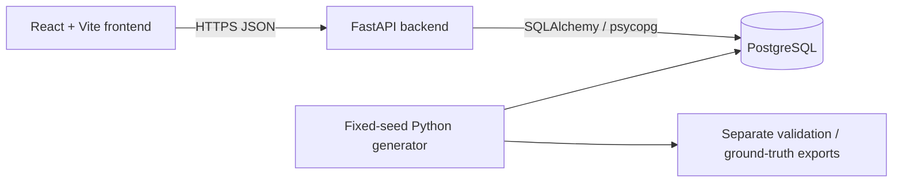

# PayLens architecture

## Three tiers

The frontend and backend have independent build/deployment roots. PostgreSQL is the persistent data tier. Local development supports SQLite; Docker Compose runs PostgreSQL with private networking, a one-time initialization service, FastAPI and an Nginx frontend. Only Nginx port 8080 is published. Cloud deployment targets separate Vercel UI/API projects and a dedicated Supabase PostgreSQL project.

## Implemented modules

- `backend/models.py`: employee, role, level, location, bands, assignments, salaries, evidence, promotions, tenure, source decisions, analysis snapshots, proposals and audit events. See [data dictionary](docs/data_dictionary.md) for fields and relationships.
- `backend/analysis.py`: effective-date resolution, FTE/currency normalization, band ratios, documented-factor expected pay, source anomaly detection and immutable comparison snapshots.
- `backend/main.py`: REST routes, role checks, optimistic proposal transitions and atomic application of approved adjustments.
- `backend/db.py` and `backend/migrations/`: database initialization, Alembic upgrades and append-only history guards.
- `backend/generate.py`: master records first, dependent histories, labelled scenarios and deterministic exports with seed 20261022.
- `backend/validation.py`: integrity, arithmetic, lifecycle and export-checksum checks.
- `backend/evaluation.py` and `backend/reporting.py`: independent ground-truth evaluation and quality reports. Detection does not read labels. Missing or mismatched evaluation artifacts return unavailable results.

## Review workflow

Resolve an employee's salary, effective assignment, band and FX rate; calculate annual full-time-equivalent pay, compa-ratio and band position; compare against documented factors and role/level/location peers; persist evidence and exceptions. HR reviews a result and creates a proposal. The workflow is `draft -> submitted -> approved/rejected`, followed by `approved -> applied`. Applying an approved proposal appends a salary event and approval history in one transaction. Stale versions and duplicate applications are rejected.

## Delivery and verification

Source code, dependency manifests, migrations, tests, CI and required UI assets are committed. Data exports and secrets are generated or configured separately. See [test coverage](docs/testing.md), [Compose setup](docs/three-tier.md) and [Vercel setup](docs/vercel.md). Cloud deployment is not complete until database initialization and browser-to-API verification succeed.

## Current limitations

This is a synthetic-data prototype. Demo headers are not production authentication; real employee data requires SSO and record-level authorization. Expected pay uses deterministic factors, not a fitted regression. Comparable groups are role/level/location keys, not editable many-to-many groups. Approval has one manager decision followed by HR application. The source-decision history is not a complete point-in-time event replay. Service/repository extraction, generated API types, request tracing and production rate limiting remain future work. See [current build](docs/current-build.md) for verified scope.
